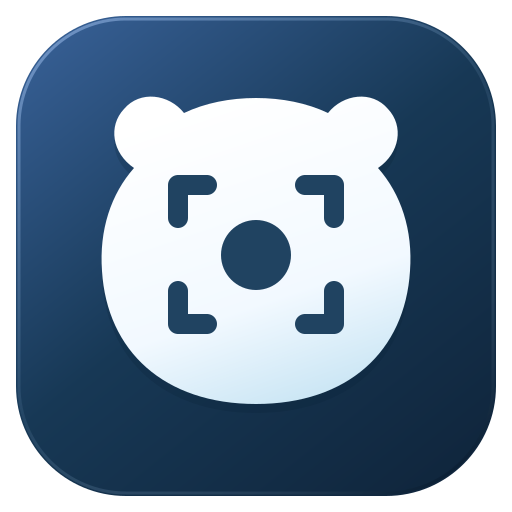

# PolarRec · 폴라렉



**0.4.0 · Windows 10 / 11 x64**

[설치 및 사용 가이드](docs/USER-GUIDE.md) · [릴리스](https://github.com/Polar-Little-Lab/polarRec/releases) · [웹사이트](https://polar-apps-lab.namsh11251.chatgpt.site/apps/polarrec/)

화면과 PC 전체 소리·마이크를 함께 녹화하는 앱입니다. **FFmpeg와 .NET 런타임을 포함했으므로 별도 설치나 파일 선택이 필요하지 않습니다.**

## 시작하기

1. `PolarRec-0.4.0-Setup.exe`를 실행하고 설치하세요.
2. 바탕화면 또는 시작 메뉴의 **PolarRec**을 실행하세요.
3. 전체 화면 또는 선택 영역을 정하고 PC 전체 소리·마이크를 켜세요.
4. **녹화 시작**을 누르세요. 3초 후 창이 최소화됩니다.
5. 저장하려면 **Ctrl + Shift + F9**, 일시정지/계속은 **Ctrl + Shift + F10**을 누르세요.

기존 버전은 종료한 뒤 설치하세요. 기존 설정과 영상 폴더를 이어서 사용합니다.

## 편의 기능

- Frost 밝은 디자인, 녹화 / 내 녹화 / 설정 화면
- 선택 모니터 전체 또는 드래그한 영역 녹화
- 앱·브라우저 창 선택 녹화 (Windows 10 1903 이상): 창 이동·크기 변경 대응
- 웹 탭을 바꾸면 해당 창의 바뀐 탭이 녹화됩니다. PC 전체 소리를 켜면 다른 앱 소리도 포함됩니다.
- PC 전체 소리와 마이크 동시 녹음
- 시작 대기 취소: Esc 또는 시작 취소 버튼
- 미리보기 새로고침: 화면을 한 번 캡처해 확인. 파일 저장이나 외부 전송 없음
- 일시정지 후 이어 녹화, MP4 저장, 영상 바로 열기
- 현재 저장 폴더의 최근 MP4 50개 표시
- 저장 폴더와 오디오 옵션 자동 기억

## 앱 파일 누락 안내가 나오는 경우

설치 프로그램을 다시 실행하세요. 앱 내부 구성 요소는 자동 연결되며 경로를 지정할 필요가 없습니다.
보안 프로그램이 파일을 격리했는지 확인하고, 회사 PC라면 담당자에게 문의하세요.
설정 파일에 남아 있는 예전 FFmpeg 경로는 무시합니다.

## 확인된 범위

Windows x64 Release 빌드와 패키지 무결성 확인을 완료했습니다.
현재 개발 환경은 Linux이므로 실제 Windows 화면 캡처·WASAPI 녹음·음성 동기화·DPI는 실기기 확인이 필요합니다.
60분 연속 구간마다 임시 오디오 파일 보호를 위해 일시정지하며 계속 녹화할 수 있습니다.
현재 사용자용 설치 프로그램을 제공합니다. 코드 서명과 자동 업데이트는 포함하지 않습니다.

저장 실패 시 저장 폴더의 `.polar-work/<세션 ID>/`에 원본과 로그가 남습니다. 복구 전 삭제하지 마세요.
`concat.txt`가 있으면 확정된 구간을 앱에 포함된 엔진으로 합칠 수 있습니다(고급 복구용):

```powershell
& '앱폴더\tools\ffmpeg.exe' -f concat -safe 1 -i concat.txt -c copy -movflags +faststart recovered.mp4
```

## 개발자용

.NET 8 SDK 설치 후 `scripts/build.ps1`을 실행하면 엔진을 포함한 `dist/PolarRec`를 만듭니다.
소스만 있는 경우 스크립트가 검토된 배포 파일을 다운로드하고 SHA-256을 확인합니다. 배포처 파일이 변경되면 빌드를 중단하므로 버전과 해시를 검토해 갱신해야 합니다.
일반 사용자는 이 스크립트를 실행할 필요가 없습니다.

공통 UI 규칙은 `docs/DESIGN-SYSTEM.md`, 변경·검증 결과는 `BUILD-REPORT.md`를 참고하세요.
`docs/Frost-preview.png`는 0.2 디자인 시안이며 실제 Windows 실행 캡처가 아닙니다.

## 포함 구성 요소

- NAudio 2.2.1 (MIT): `app/licenses/NAudio-MIT.txt`
- .NET / Windows Desktop runtime: `app/licenses/`
- FFmpeg 9.0.2 essentials Windows x64 static build (Gyan): `app/tools/ffmpeg.exe`
- FFmpeg 배포 원문 라이선스(GPL v3)와 구성·소스 정보: `app/tools/LICENSE`, `app/tools/README.txt`
- 배포처: https://www.gyan.dev/ffmpeg/builds/
- 배포처가 지정한 FFmpeg 소스: https://github.com/FFmpeg/FFmpeg/commit/946fcce07b

FFmpeg는 별도 프로세스로 호출하며 바이너리를 변경하지 않았습니다. 재배포 시 포함된 고지와 라이선스·소스 제공 조건을 유지해야 합니다.

## 0.3.1 화면 개선

- 실행 파일·창·작업 표시줄·앱 내부 로고에 Frost 앱 아이콘 적용
- 새로고침 버튼을 미리보기 제목과 수직 중앙 정렬, 아래 여백 14 DIP
- 새로고침 선 아이콘, 접근성 이름 유지
- 시작 버튼 글자색 상속 수정으로 흰 글자 대비 확보
- 내용 스크롤 영역의 큰 점선 포커스 테두리 제거. 버튼의 키보드 포커스는 유지
- 아이콘 원본 SVG·PNG 및 다중 해상도 ICO: src/PolarRecorder/Assets/

## 브랜드 아이콘

B 포커스 아이콘 적용: PolarSH와 같은 남색 배경·흰 북극곰 얼굴에 화면 영역 프레임과 녹화 점을 배치했습니다. 앱 내부 로고, 실행 파일, 창·작업 표시줄, 설치·제거 프로그램에 동일하게 적용했습니다.
